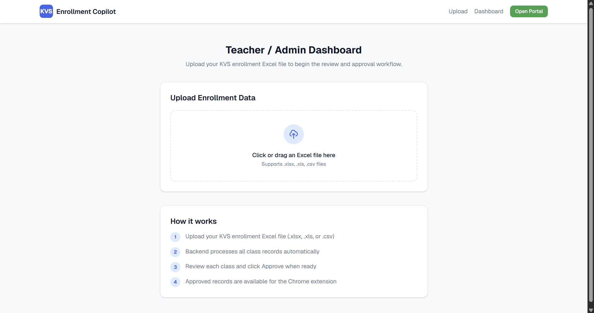
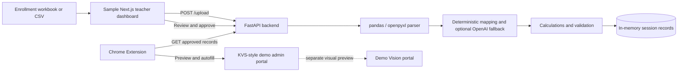

# KVS Copilot


**From messy enrollment data to reviewed, ready-to-enter records.**

KVS Copilot is a KVS-focused hackathon MVP that helps teachers process enrollment spreadsheets, review calculated class records, and transfer approved values into a KVS-style statistics form with a Chrome extension.

## Overview

KVS teachers work with school-specific Excel files and enter statistics through a similar teacher-facing KVS portal workflow. Calculating totals, matching columns, and copying values into portal fields can be repetitive and error-prone. After a teacher submits data through the KVS entry portal, it is used to update that school's public KVS website.

This MVP demonstrates a controlled workflow: upload an enrollment sheet, normalize and map its columns, calculate and validate class records, review and approve them in a sample dashboard, then use the extension to preview and fill matching fields in the included demo admin portal. The sample dashboard is a prototype, not the official KVS-maintained teacher dashboard.

**Scope note:** the repository does not connect to the official KVS teacher portal or publish data to a school's public website. The extension targets the included KVS-style demo portal. A teacher must review and submit a form there; the public KVS update step is part of the real-world workflow the project is intended to support, not a live integration in this checkout.

**Hackathon vision vs. implementation:** the submission proposed AI-assisted spreadsheet interpretation, calculation and validation, teacher approval, and browser-assisted portal entry. This repository implements that workflow as an MVP, but its AI mapper is an optional OpenAI fallback (the presentation names Gemini), its records are in memory, and its extension targets a demo portal rather than the official KVS system.

## Demo and screenshot

The video shows the application as it existed during the hackathon. It is a historical project demo, not evidence of a currently maintained or operational live deployment.

[](docs/media/kvs-copilot-demo.mp4)

*▶ Click the thumbnail to open or download the historical demo recording. The screenshot is from the sample teacher dashboard.*

## Features

### Implemented in this repository

- Upload an enrollment workbook or CSV through the sample teacher dashboard.
- Parse KVS-style spreadsheets, including merged multi-row headers and simpler single-row headers.
- Match known columns with deterministic aliases and naming rules; use an optional OpenAI fallback for unresolved column names.
- Build class or section records, calculate derived enrollment fields, and flag unresolved mappings for review.
- Check enrollment totals and social-category sums; show warnings rather than silently correcting source values.
- Review records in the dashboard and approve them individually.
- Fetch approved records through the API and show the matching class data in the Chrome extension.
- Autofill corresponding fields in the supported demo admin portal after the user chooses **Start Auto-Fill**.

### Not implemented in this checkout

- Authentication, user roles, or school isolation.
- Persistent database storage. Backend records are held in process memory and are lost when the server restarts.
- A connection to the official KVS teacher portal, automated form submission, or publication to a school's public website.
- Full processing and autofill for admission-category status, transfer certificates, or student vacancies. Those sections appear in the demo portal's navigation but are not complete end-to-end workflows.

## Technology stack

| Area | Verified technologies and implementation |
| --- | --- |
| Teacher dashboard | Next.js App Router, React, TypeScript, Tailwind CSS |
| Backend API | Python, FastAPI, Uvicorn, Pydantic |
| Spreadsheet processing | pandas and openpyxl; CSV parsing through pandas |
| AI-assisted mapping | OpenAI Python SDK; `gpt-4o-mini` is called only as a fallback when deterministic mapping cannot resolve fields. Requires `OPENAI_API_KEY`. |
| Calculations and validation | Python rule-based calculations and validation; totals are not delegated to the AI model |
| Browser integration | Chrome Extension Manifest V3, JavaScript content and background scripts |
| Demo portal | Separate React/Vite admin prototype and React/TanStack Vision preview under `website-demo/` |
| Database / persistence | The KVS Copilot API stores records in Python process memory. A separate Drizzle/PostgreSQL scaffold exists under `website-demo/apps/admin/lib/db`, but it is not wired into this workflow. |
| Deployment | No maintained deployment workflow for the integrated MVP is included. A demo Vercel config and legacy Railway/Vercel endpoint defaults exist; their current status is unknown. |

The submission presentation mentions Gemini, while the checked-in mapper imports the OpenAI SDK and calls `gpt-4o-mini`. This README describes the implementation in the repository.

## Architecture



The API stores records in process memory, so the dashboard, API, and extension must use the same running backend process. Approval controls which records the extension receives. The demo Vision portal is a separate mockup; it does not receive a live KVS submission or update a public school site.

## Project structure

```text
KVS-COPILOT/
├── backend/
│   └── main.py                 # FastAPI routes and in-memory session state
├── services/
│   ├── excel_parser.py         # Excel/CSV normalization and header handling
│   ├── ai_mapper.py            # Rule-based column matching and OpenAI fallback
│   ├── calculator.py           # Class identity and enrollment calculations
│   └── validator.py            # Totals and category consistency checks
├── models/
│   └── schemas.py              # Pydantic response and record models
├── teacher-dashboard/          # Next.js upload, records, and review UI
│   ├── app/
│   ├── components/
│   └── lib/api.ts              # Dashboard API calls and legacy URL defaults
├── extension/                  # Manifest V3 demo portal integration
│   ├── manifest.json
│   ├── background.js
│   ├── content.js
│   └── popup.js
├── website-demo/                # Separate admin mockup and public Vision preview
├── docs/
│   ├── API_CONTRACT.md
│   └── media/                   # README screenshot and hackathon recording
├── requirements.txt
└── test_api.py                  # Small API smoke script
```

## API

The FastAPI service runs without authentication. Requests and responses use JSON except for spreadsheet uploads. The service currently has permissive CORS configuration. Important routes:

| Method and path | Purpose |
| --- | --- |
| `POST /upload` | Upload a file as `multipart/form-data` field `file`; parses the sheet and prepares default-session records. |
| `GET /fields` | Return detected column names after an upload. |
| `POST /prepare/{session_id}` | Rebuild records for a session from the currently uploaded file. |
| `POST /compute` | Compute or upsert one class/section record. Example body: `{"class":"1","section":"A"}` or `{"id":"1-A"}`. Optional `session_id` defaults to `default`. |
| `GET /api/records/{session_id}` | Return approved and unapproved records in a session. |
| `POST /approve/{session_id}/{record_id}` | Mark one existing record approved; no request body is required. |
| `GET /api/approved/{session_id}` | Return only approved records for extension use. |
| `GET /` | Basic backend status response. |

`POST /upload` returns an `upload` object (`columns`, `rows`, `source_file`, `source_date`) and a `prepared` object (`sessionId`, `section`, `approved`, `recordCount`, `records`, `unresolved_fields`, `needs_review`, `warnings`). Records begin unapproved.

Other response shapes: `GET /fields` returns `available_columns`; `GET /api/records/{session_id}` returns `sessionId`, `recordCount`, and `records`; `GET /api/approved/{session_id}` returns `sessionId`, `section`, `approved`, `recordCount`, and approved `records`; `POST /approve/...` returns `status`, `recordId`, and `approved`; and `POST /compute` returns `status`, `record`, `needs_review`, and `warnings` for the per-record request.

`POST /upload` accepts `.xlsx` and `.csv` in the checked-in parser. Error responses use FastAPI's JSON `detail` field. There is no API authentication. See [docs/API_CONTRACT.md](docs/API_CONTRACT.md) for the older and compatibility request shapes; the route implementation is the source of truth where they differ.

## Environment variables

Create local environment files or set variables in your shell. Use your own values; do not commit keys or credentials.

| Variable | Component | Purpose |
| --- | --- | --- |
| `OPENAI_API_KEY` | Backend | Optional key for the OpenAI mapping fallback. If absent, deterministic matches still work and unresolved fields are returned for review. |
| `NEXT_PUBLIC_API_BASE_URL` | Teacher dashboard | FastAPI base URL. For local development, use `http://127.0.0.1:8000`. |
| `NEXT_PUBLIC_PORTAL_URL` | Teacher dashboard | Demo portal URL opened from the dashboard. Set to your local demo admin URL when applicable. |
| `DATABASE_URL` | Separate Drizzle/PostgreSQL scaffold | PostgreSQL connection string required only if using that scaffold; it is not used by the Python API workflow. Example: `postgresql://<user>:<password>@<host>:<port>/<database>`. |
| `PORT`, `LOG_LEVEL` | Separate Express API scaffold | The scaffold requires a listening port; `LOG_LEVEL` defaults to `info`. These are not needed for the Python API. |

Example `teacher-dashboard/.env.local`:

```dotenv
NEXT_PUBLIC_API_BASE_URL=http://127.0.0.1:8000
NEXT_PUBLIC_PORTAL_URL=http://localhost:5174
```

The backend and extension contain legacy service URLs in source rather than environment configuration. The extension's manifest also matches a fixed demo origin; local use requires configuring those origins to match the local demo host.

## Getting started

### Prerequisites

- Python 3.10 or newer for the backend.
- Node.js and npm compatible with the checked-in Next.js 16 package lock for the teacher dashboard.
- pnpm for the separate `website-demo/apps/admin` workspace.
- Google Chrome to load the Manifest V3 extension.

### Historical local setup (not verified in this update)

These commands are based on the checked-in requirements and package manifests. The project was developed as a hackathon MVP, and the live services and old deployment URLs have not been verified. Local app startup and extension compatibility may require adjustments.

#### Backend

From the repository root:

```bash
python -m venv .venv
```

Activate the environment, then install dependencies and start the API:

```bash
# macOS/Linux
source .venv/bin/activate
python -m pip install -r requirements.txt
python -m uvicorn backend.main:app --reload --host 127.0.0.1 --port 8000
```

PowerShell equivalent for activation:

```powershell
.\.venv\Scripts\Activate.ps1
python -m pip install -r requirements.txt
python -m uvicorn backend.main:app --reload --host 127.0.0.1 --port 8000
```

Set `OPENAI_API_KEY` in the shell if you want the AI fallback. Keep it private. The API otherwise uses deterministic mapping where possible and reports unresolved fields.

#### Teacher dashboard

In a second terminal:

```bash
cd teacher-dashboard
npm ci
npm run dev
```

Create `.env.local` using the example above before starting Next.js. The dashboard uses the base URL configured in `NEXT_PUBLIC_API_BASE_URL`.

#### Demo portal and extension

The separate demo portal lives in `website-demo/`. The admin mockup can be started from its pnpm workspace:

```bash
cd website-demo/apps/admin
pnpm install
pnpm --filter @workspace/kvs-demo-admin dev
```

The Vision preview app has its own npm lockfile:

```bash
cd website-demo/apps/vision
npm ci
npm run dev
```

These portal commands are also historical and unverified. The extension's current match patterns and backend URL are hard-coded to legacy deployed origins, so the extension is not ready for local use without changing those origins. The deployed domains are not asserted to be operational.

To load the historical extension build in Chrome, open `chrome://extensions`, enable **Developer mode**, choose **Load unpacked**, and select `extension/`. Only use it with the supported demo portal.

## Challenges and technical highlights

- **Variable spreadsheet layouts:** pandas reads both multi-row KVS-style headers and single-row exports; merged header labels are forward-filled and duplicate names are normalized.
- **Safe column mapping:** aliases and suffix rules run first. OpenAI is a fallback for unresolved columns, and returned matches are checked against actual column names. The similarity score is a heuristic, not a calibrated confidence probability.
- **Human review:** unresolved or ambiguous mappings are surfaced; validation reports mismatched totals instead of silently changing data.
- **Correct class matching:** normalized class and section identifiers keep sibling records distinct before the extension fills a form.
- **Approval-gated data:** only records marked approved are returned by the extension endpoint.

## Team and contributions

| Item | Details |
| --- | --- |
| Team | Commit Squared |
| Hackathon | Code Build 1.0 |
| Theme | Open Innovation (EdTech + AI/ML) |
| Members | Gargi Tyagi; Samriddhi Singh |

The submission does not specify individual roles, so none are assigned here.

## Project status

KVS Copilot was developed as a hackathon MVP several months ago and is **no longer actively maintained**. The demonstration video reflects the application at the time of development. The live deployment may no longer be functional; no current production operation is claimed. This repository is preserved as a record of the hackathon project and its implementation. It demonstrates upload, mapping, validation, review, approval, and demo-form autofill, not integration that submits data to KVS or publishes it on school websites.

## Future ideas (not implemented)

- Add persistent, school-scoped storage and authentication.
- Configure portal origins and service endpoints outside source code.
- Evaluate additional KVS statistics sections beyond class-wise enrollment.
- Add current integration tests and deployment documentation before any renewed use.

## License

No license has been specified for this project.
